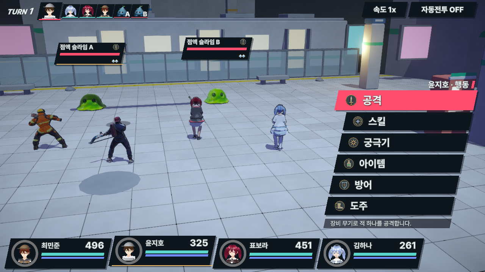
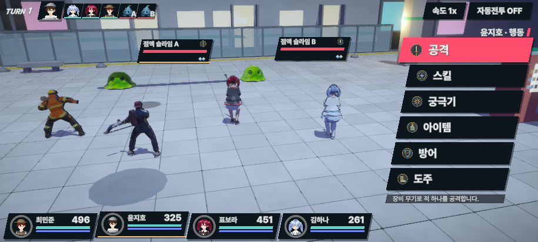

# PR9 전투·이펙트 개선 검증 — 2026-10-15

`claude/motion-polish-pr9`의 기존 작업을 보존하면서 확인된 전투·UI·게임 진행 결함을 수정했다. 전체 로직 테스트 **259/259**, 실제 Unity 전투·애니메이션·화면 검사 **67개**가 통과했다. 독립 코드 검토에서 이번 수정의 추가 결함은 발견되지 않았다.

## 반영한 변경

- **스킬·피해 표시:** 빙결 대상 다단 물리 공격의 예상 피해가 첫 타 이후에도 빙결 배율을 적용하던 문제 수정. MP 실드 흡수량 표시와 100% 치명타의 RNG 경계 수정.
- **이펙트:** 생성·배속 변경·풀 재사용 시 TrailRenderer 수명을 배속에 맞춤. 화살은 1배속 0.12초, 2배속 0.06초. 비정상 배속 입력도 유한하게 처리.
- **적과 보스:** 적 7종의 MP 부족으로 막혔던 기술 12개 활성화. 고철 거인 공격/마력과 역병 리치 HP를 소폭 조정해 기존 밸런스 기준 통과. 기술·차지·단계 구성 유지.
- **파티·장비·상점:** 여관의 예비 인원 회복, 예비 장비 소유량, 판매 금액 overflow, 자동 장비 배분 시 여분 복사본 활용 수정.
- **퀘스트·탐험:** 일회성 레드게이트 승리 후 늦게 받은 퀘스트 진행 복구. 소진한 회복 키트의 지도 표시와 귀환 보충 검증.
- **입력·HUD:** 비활성 버튼 실행 및 비왼쪽 클릭 방지. 화면 크기 변경 후 적 고정/위협 표시 보존. 부활 아이템은 쓰러진 대상만 선택 가능.
- **자원 수명:** Atmosphere가 직접 만든 프로필·효과만 해제하고 외부 프로필은 보존.

## 실제 검증

| 검증 | 결과 | 근거 |
|---|---:|---|
| 전체 로직 회귀 | 259/259 | [로그](final-logic-tests.log) |
| VFX 생성·속도 변경·재사용 | 42 | [런타임](vfx-runtime.json), [캡처 수치](vfx-visual.json) |
| Unity 버튼/탭 핸들러 | 43 | [런타임](input-runtime.json) |
| 프로필·효과 해제 | 32 | [런타임](atmosphere-runtime.json) |
| HUD 재생성 | 일반 121, compact 121 | [일반](hud-normal.json), [compact](hud-compact.json) |
| 1280→915 실제 화면 전환 | 13 | [상태 보존](hud-resize.json) |
| 부활 메뉴·확인·취소·소비 | 25 | [런타임](item-target-runtime.json) |
| 전투·클립·스킨 변형·구도 | 67 | [런타임](battle-checks.json) |
| 새 실행 최종 콘솔 | 오류 0, 경고 0 | [상태](final-console.json) |

네 영웅의 클립 시간이 진행되고 BakeMesh 정점이 변형되는 것을 확인했다. 전경은 여섯 유닛 모두, 명령 선택은 행동할 영웅과 적들의 몸체가 HUD 밖의 가시 영역 안에 들어오는지 검사했다. 명령 카메라는 의도적으로 다른 파티원을 모두 담지 않는다. 캡처 네 장을 직접 확인했으며 최종 전투 검사 중 경고/오류가 없었다.

[1280 명령 선택](battle-1280x720.png) · [915 명령 선택](battle-915x412.png) · [화살 1배속](arrow-1x.png) · [화살 2배속](arrow-2x.png)

[부모 시각 검토·캡처 해시](visual-review.json) · [최종 생산 코드 해시](source-hashes.json) · [CLI 완료 기록](completed-cli-workers.json) · [diff 검사](diff-check.json)

화살 캡처는 동일 경로의 근접한 진행 시점이며 프레임 단위로 동기화한 비교는 아니다. 두 배속 모두 잔상이 표시되며 2배속 수명이 절반으로 설정되는 것을 실제 객체에서 확인했다.

## Tripo 결과

기존 최적화된 `h_dohyun`으로 Studio Humanoid/Mixamo 리깅과 3초 주문 동작을 시험했다. **구독 크레딧 순사용 40**, 잔액 3500→3460. 첫 동작 생성 서버 오류는 환불됐고 같은 프롬프트 재시도가 성공했다. API는 사용하지 않았다.

FBX는 **9435 triangles / 65 bones / 가중치 없는 정점 0개**이며 Blender에서 팔 뼈 회전으로 **791개 정점이 이동**했다. 원본·프롬프트·해시는 [ArtSource 기록](../../../ArtSource/hunters/_anim_library/tripo_spell_20261015/SOURCE.md)에 보존했다.

다섯 포즈를 확인한 결과 정면 손바닥 발사와 곧게 선 회복 동작이 충분하지 않았다. **리깅은 통과했지만 동작은 채택하지 않았다.** 기존 게임의 공용 Spell을 유지하고 후보를 원본 자료로만 저장했다. 새 동작의 게임 통합을 완료했다고 주장하지 않는다. 다운로드 후 Tripo 탭을 닫았다.

## 검토·보존·정리

30개 범위로 나눠 기존 3개 작업과 추가 CLI 27개, 후속 수정 CLI 8개의 기록을 남겼다. CLI 35개 모두 exit 0과 보고서를 확인했다. 모든 시점에 30개가 동시에 실행됐다는 뜻은 아니다. 요청 인자는 Astra/high/priority였으나 서버의 Fast 처리 여부는 별도 확인할 수 없다. 이후 제공된 AGENTS 규칙에 따라 마지막 독립 검토는 Sol high 1개로 수행했다. 전역 에이전트 기본값·동시 실행 제한은 원래 Luna/high/1로 복원했다.

[UI·VFX 통합 검토](integration-review-report.md)와 [최종 델타 검토](final-delta-review.md)를 구현자와 분리했다. 마지막 검토 이후 QA 스크립트에 전경/명령 구도별 검사를 추가했고 부모가 소스 확인 및 실행했다. 생산 코드의 추가 변경은 없었다.

시작 시 변경 232개를 패치로 보관했다. 기존 변경/미추적 파일 339개 해시 재검사 결과 **삭제 0, 동일 334, 의도한 수정 5**. [보존 결과](final-baseline-preservation.json). 다섯 파일은 적 데이터, 생성기 두 파일, 빙결 미리보기, HUD 카드 코드다. 원본 사본·실패 로그·전체 작업 기록은 `.git/codex-runs/20261015-165918-tripo-motion/`에 있다. Unity 로그와 로컬 편집기 레이아웃은 실행 과정에서 갱신됐다.

첫 통합 테스트 258/259의 실패를 보존하고 CampaignBalance만 좁혀 수정했다. 통과 후 전체 테스트를 한 번 재실행해 259/259 확인. [밸런스 수치](balance-report.md). 테스트 조건·시드는 완화하지 않았다. 고철 거인 미준비 승률 25%는 고정 60시드의 하한이며 미측정 시드의 여유를 보장하지 않는다. 수정 행은 생성기와 JSON이 일치하고, 기존 다른 25개 행의 차이는 보존했다.

QA는 별도 저장 폴더를 사용했다. 종료 후 Play Mode를 끄고 임시 GameView 해상도를 제거했으며 원래 배경 실행 설정을 유지했다. [정리 결과](cleanup.json). 작업자 모두 종료. 커밋·푸시는 하지 않았다.

## 범위의 한계

실제 Android 터치, 캠페인 전체 시각 검증, 모든 모델/연출 재검증은 포함하지 않는다. 입력은 Unity 실제 핸들러에 합성 입력을 전달했다. 기존 trail 점의 타임스탬프를 다시 쓰거나 로컬 배속 0만으로 잔상 노화를 완전히 멈추지는 않는다. 초기 Play 중 코드 reload 오류와 QA 해상도 정리 오류는 실패 증거로 보존했다. 새 Play와 수정 QA의 최종 검증은 오류 없이 통과했다.
